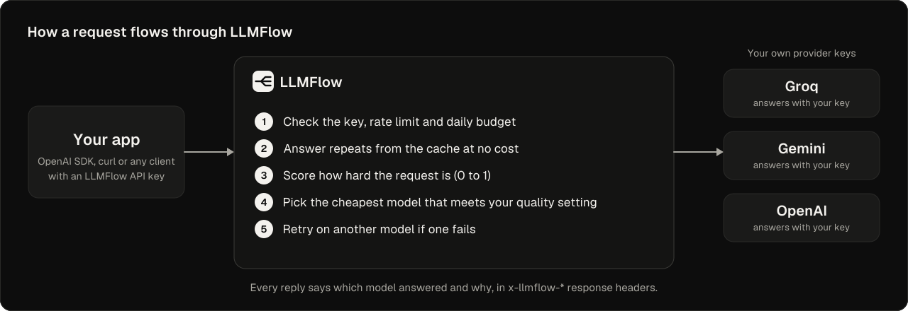
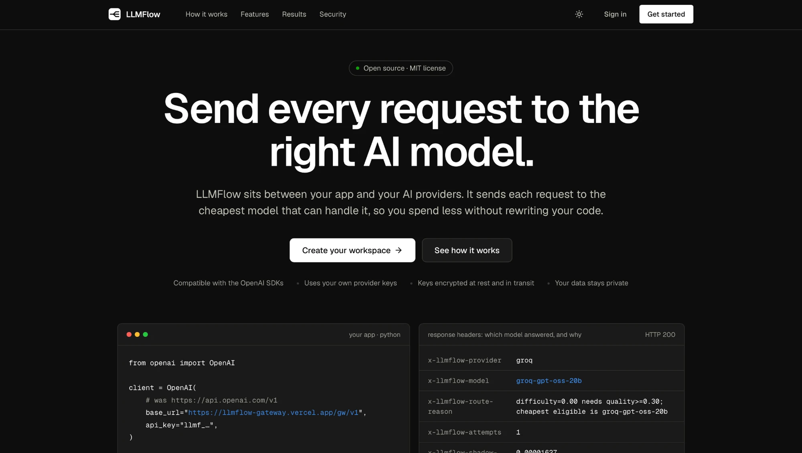
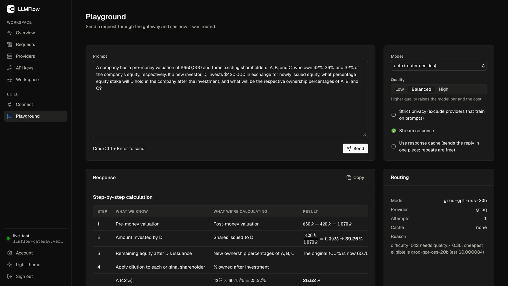
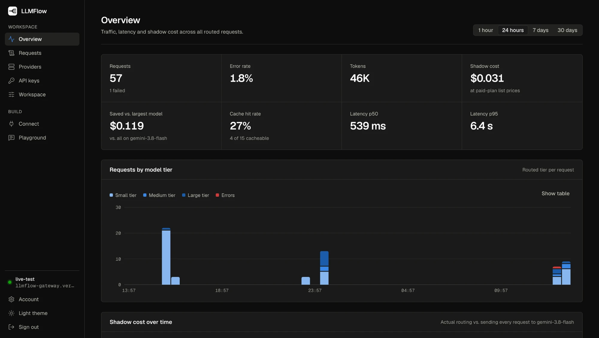
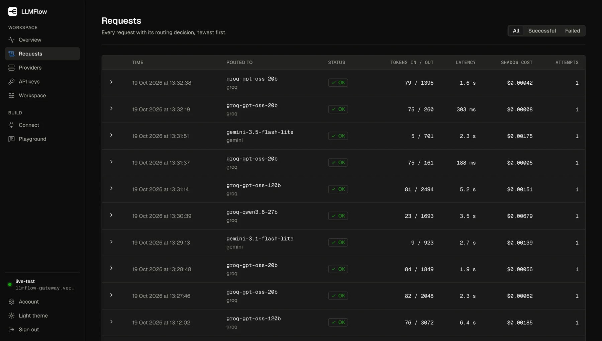

<p align="center">
  
</p>

**An OpenAI-compatible LLM gateway that routes each request to the cheapest model that meets your
quality setting, using each user's own provider keys.**

Point any app that speaks the OpenAI API at LLMFlow, add your own Groq (or other OpenAI-compatible)
key once, and LLMFlow picks a model per request, falls back when a provider is rate-limited or down,
caches deterministic requests, enforces budgets, and shows you what it did and what it cost.

<p align="center">
  <b><a href="https://llmflow-gateway.vercel.app">Live demo</a></b> &nbsp;·&nbsp;
  <a href="#quick-start">Quick start</a> &nbsp;·&nbsp;
  <a href="docs/SECURITY.md">Security</a> &nbsp;·&nbsp;
  <a href="benchmarks/README.md">Benchmarks</a>
</p>

<p align="center">
  
</p>

> **Status:** deployed on free tiers (Vercel, Render, Neon) and verified live with Groq. Gemini
> answered a direct test call; streaming through the gateway and OpenAI are untested. Sign-up on
> the live demo is invite-only, and the API sleeps after about 15 idle minutes, so the first request
> can take around 30 seconds. See [Scope and status](#scope-and-status).

## Screenshots

<p align="center">
  
</p>

The landing page (it also has a light theme). The images below are from the live deployment with a
few dozen test requests; the dashboard itself sits behind sign-in.

**Playground**: send a request and see how it was routed. The reply is rendered as formatted
text (tables, math, code), and the Routing panel says which model answered and why.

<p align="center">
  
</p>

**Overview**: traffic, error rate, tokens, shadow cost, the estimated saving versus always using the
largest model, cache hit rate, latency, and the model tier each request was routed to.

<p align="center">
  
</p>

**Requests**: every request with its routing decision (model, provider, status, tokens, latency,
shadow cost, attempts), across Groq and Gemini models.

<p align="center">
  
</p>

## Features

- **Drop-in OpenAI API**: `POST /v1/chat/completions` (including streaming) and `GET /v1/models`.
  Change `base_url` and `api_key`; nothing else.
- **Cost-aware routing**: a transparent difficulty score and a `quality` dial pick the cheapest model
  that meets a quality bar; every response carries `x-llmflow-*` headers explaining the decision.
- **Bring your own keys**: each workspace adds its own provider keys, encrypted at rest and sent
  only over TLS on hosted deployments. They are masked in the dashboard, shown again only
  after you re-enter your password, and used only for that workspace's requests. A provider can
  be **paused** (key kept, never routed to) and resumed; removing a key needs your password.
- **Resilience**: per-model quota tracking, cooldowns that honour `Retry-After`, bounded fallback
  across models, streaming fallback before the first byte.
- **Cost controls**: exact-match response cache, per-workspace rate limits, and daily token and
  cost budgets. A **Workspace** settings page sets the caching mode (auto / always / off), the
  default quality and daily limits for every request from your apps.
- **Observability**: usage, latency, tier mix and "shadow cost" (what the same tokens would cost at
  paid list prices), a request log with routing reasons, and a per-workspace security audit log.
- **Security-first accounts**: email + password (argon2id) with a complexity policy, lockout,
  one-time recovery codes, optional TOTP two-factor, and named, revocable API keys that cannot
  manage the workspace.
- **Web dashboard**: public landing page, then Overview (with a first-run checklist), Requests,
  Providers, API keys, Workspace settings, Connect and a Playground that renders replies as
  formatted Markdown (tables, lists, code with a copy button, math) and shows the routing decision. The Account page lists active sessions (sign out
  any device) and can permanently delete the workspace and its data.
- **Reproducible benchmark and router evaluation**: fixed-model runs on public and generated suites,
  with offline replay of routing policies ([results](benchmarks/README.md)).

## Quick start

Requirements: Node 20+ and Python 3.12+. No paid services are needed.

```bash
git clone <this repo> && cd llmflow
npm run dev
```

On first run this creates a virtualenv, installs dependencies, and generates local keys in
`backend/.env`. Then:

1. Open <http://localhost:5173> and choose **Get started** to create a workspace. Passwords need
   12+ characters with upper and lower case, a number and a symbol.
2. Save the API key and recovery codes shown (once).
3. **Providers**: paste your own Groq key (get a free one at <https://console.groq.com>).
4. **Connect**: copy the snippet into your app, or try the **Playground**.

Prefer to see it work first? `npm run demo` starts everything and runs a scripted tour through the
official OpenAI SDK (set `GROQ_API_KEY` in `backend/.env` first).

## Using it from your code

```python
from openai import OpenAI

client = OpenAI(base_url="http://localhost:8000/v1", api_key="<your LLMFlow API key>")

reply = client.chat.completions.create(
    model="auto",                                   # let LLMFlow choose, or pin a model id
    messages=[{"role": "user", "content": "Hello!"}],
    extra_body={"llmflow": {"quality": "balanced"}},  # optional: low | balanced | high
)
print(reply.choices[0].message.content)
```

Or with no code changes at all:

```bash
export OPENAI_BASE_URL=http://localhost:8000/v1
export OPENAI_API_KEY=<your LLMFlow API key>
```

Per-request options go in an `llmflow` object:

| Field | Values | Effect |
|---|---|---|
| `quality` | `low` / `balanced` / `high` | raises or lowers the model bar (and cost) |
| `privacy` | `standard` / `strict` | `strict` excludes providers flagged as training on prompts |
| `fallback` | `true` / `false` | `false` = fail rather than try another model. A request that names a model never falls back unless you set `true` |
| `cache` | `auto` / `on` / `off` | `auto` caches only non-streaming `temperature: 0` requests |

Repeated identical requests that are cacheable return instantly at no cost (`x-llmflow-cache: hit`).
In the Playground, tick **Use response cache** to try it.

> LLMFlow works with clients that let you set an API base URL (SDKs, LangChain, Open WebUI,
> LibreChat, Cursor-style tools). The ChatGPT website/app has no such setting and cannot be pointed
> at it.

## How routing works

1. The request is scored from cheap, inspectable features (length, code, maths, reasoning cues,
   numeric load, structured-output demands, conversation depth).
2. The score plus your `quality` setting (`low`, `balanced`, `high`) give a required quality level.
3. Models of the providers you connected are filtered by context window, remaining quota, health,
   and privacy, then the cheapest one that meets the bar is chosen, with the rest as a fallback chain.

Routing is rule-based and fully explainable: every response says which model was used and why.

### Measured results (Groq, real API calls, deterministic scoring)

| Setting | Model used | Accuracy | Shadow cost vs. always-large |
|---|---|---|---|
| `quality: high` | 120B | 99.0% (96-item mixed suite) | baseline |
| `quality: low` | 20B | 89.6% (same suite) | **-34%** |
| GSM8K sample (36 real problems) | 20B | 97% (large: 100%) | **-39%** |
| Easy/medium suite (round 1, 44 items) | routed `balanced` | 100% (same as large) | **-45%** |
| Repeated deterministic requests | cache | identical answer | **$0** |

The `quality` dial gives a predictable cost/accuracy trade-off, so each application can pick its
own point on the curve per request. Method, data and caveats: [benchmarks/README.md](benchmarks/README.md).

## Security model

| Concern | Approach |
|---|---|
| People vs. apps | Humans use email + password sessions; apps use API keys. An API key cannot manage the workspace. |
| Provider keys | Verified on save, encrypted at rest (Fernet) under `LLMFLOW_MASTER_KEY`, bound to tenant and provider, masked in the UI (last four only) and returned only after password (and 2FA) re-confirmation, which is audited. Sent over TLS on hosted deployments. |
| Passwords / keys | argon2id passwords with a complexity policy (length, mixed case, number, symbol, no sequences or common words); API keys and recovery codes stored only as hashes. |
| Sessions | HttpOnly cookie + per-session CSRF token; idle and absolute timeouts; revoked on password change; listed on the Account page so any device can be signed out. |
| Abuse | Per-IP and per-account throttling, request size/shape limits, parameter allow-list for upstream calls. |
| Visibility | Per-workspace audit log; no prompts or secrets are logged or stored. |
| Deletion | A workspace owner can erase the workspace, keys, request history and audit log (password and workspace name required). |

Full threat model, controls, residual risks and operator duties: [docs/SECURITY.md](docs/SECURITY.md).
**Back up `LLMFLOW_MASTER_KEY`**: without it, stored provider keys cannot be recovered.

Found a vulnerability? Please report it privately rather than opening a public issue.

## Configuration

All settings are environment variables (see [`backend/.env.example`](backend/.env.example)). The
essentials:

| Variable | Default | Purpose |
|---|---|---|
| `GROQ_API_KEY` | none | Operator provider key for your own apps (workspaces bring their own) |
| `LLMFLOW_API_KEYS` | none | Operator keys for `/v1/*` (comma separated, 16+ chars) |
| `LLMFLOW_ADMIN_API_KEYS` | none | Operator tooling only (`npm run ops`); must differ from the above |
| `LLMFLOW_MASTER_KEY` | none | Fernet key(s) encrypting workspace provider keys; empty disables workspaces |
| `LLMFLOW_SIGNUP_ENABLED` / `LLMFLOW_SIGNUP_CODE` | `false` / none | Self-service sign-up and optional invite code |
| `LLMFLOW_DATABASE_URL` | `sqlite+aiosqlite:///./llmflow.db` | SQLite file for local use; Postgres (e.g. Neon, via `postgresql://...`) for hosting. The SQLite file is git-ignored. |
| `LLMFLOW_CORS_ORIGINS` | `http://localhost:5173` | Exact dashboard origin(s) |
| `LLMFLOW_SESSION_COOKIE_SAMESITE` | `lax` | `none` (HTTPS only) when dashboard and API are on different sites |
| `LLMFLOW_TRUST_FORWARDED_FOR` | `false` | Set `true` behind exactly one trusted proxy |
| `LLMFLOW_RATE_LIMIT_RPM`, `LLMFLOW_DAILY_TOKEN_BUDGET`, `LLMFLOW_DAILY_BUDGET_USD` | 60 / unset / unset | Per-key limits |
| `LLMFLOW_CACHE_TTL_S` | `3600` | `0` disables the response cache |
| `LLMFLOW_ENABLE_DOCS` | `false` | Expose `/docs` and `/openapi.json` |

Models and providers live in [`backend/config/catalog.yaml`](backend/config/catalog.yaml) and
`backend/config/catalog.d/*.yaml` (Groq, OpenAI, Gemini). Per model, `enabled` switches it off
entirely and `auto_route: false` keeps it out of automatic routing while leaving it selectable;
per provider, `stream_usage: false` skips `stream_options` for APIs that reject it.
Add a provider without editing YAML by hand:

```bash
npm run provider -- list --base-url https://openrouter.ai/api/v1 --key-env OPENROUTER_API_KEY
npm run provider -- add --id openrouter --base-url https://openrouter.ai/api/v1 \
    --key-env OPENROUTER_API_KEY --model "meta-llama/llama-3.3-70b-instruct:free:large"
```

## Commands

| Command | Purpose |
|---|---|
| `npm run dev` | Run API (:8000) and dashboard (:5173) with first-run setup and auto-reload |
| `npm run demo` | Scripted tour through the OpenAI SDK against the running gateway |
| `npm run smoke` | 10 live end-to-end checks |
| `npm test` | Backend (pytest) and dashboard (vitest) tests |
| `npm run check` | ruff, mypy `--strict`, TypeScript |
| `npm run bench` | Routing benchmark (real calls, paced to provider quotas, resumable); results live in `benchmarks/results/` |
| `python -m llmflow.bench generate` / `eval-router` | Build harder suites (GSM8K sample + generated tasks) and replay routing policies offline; run from `backend/` with `PYTHONPATH=src` ([details](benchmarks/README.md)) |
| `npm run ops -- workspaces\|disable\|enable\|delete <id>` | Operator tooling (Bearer admin key; no web portal) |
| `npm run provider` | List or add providers |
| `npm run rotate-master-key` | Re-encrypt stored provider keys under a new master key |
| `npm run build` | Production build of the dashboard |

## Project layout

```
backend/      FastAPI gateway (api, providers, routing, security, storage, tools, bench)
dashboard/    React + TypeScript SPA: landing page and workspace dashboard
benchmarks/   Benchmark suites and measured results
docs/         Security model, deployment, testing guide, design system, research notes
examples/     OpenAI SDK quickstart
scripts/      Dev runner, demo, operator CLI, brand image generator
render.yaml   Render blueprint (API); dashboard targets any static host
AGENT.md      Project rules and decisions log
```

## SEO

The landing page ships a descriptive title and meta description, a canonical URL, Open Graph and
Twitter cards (with a generated 1200x630 preview image), JSON-LD structured data, icons and a web
manifest. `robots.txt` and `sitemap.xml` are generated at build time from `VITE_SITE_URL` (default
the live Vercel address; see [docs/DEPLOY.md](docs/DEPLOY.md)). The signed-in app is intentionally
not indexable.

## Troubleshooting

| Symptom | Cause and fix |
|---|---|
| Dashboard says it "did not reach the gateway" | The API isn't running or was started before an update. Stop `npm run dev` (Ctrl+C), start it again, then hard-refresh the page (Cmd/Ctrl+Shift+R). |
| `503 no_provider_keys` | The workspace has no provider key yet: add one under **Providers**. |
| `401` from the SDK | Use a workspace **API key** (API keys page), not your password or the provider's key. |
| The model says "I'm ChatGPT/GPT-4..." | Models' self-descriptions are unreliable (some open-weight models were trained by OpenAI). The **Routing** panel and **Requests** page show the real provider and model. |
| Provider key rejected on save | The provider refused it; create a fresh key at the provider and try again. |
| Overview shows "0 of N cacheable" | Only non-streaming `temperature: 0` requests (or `cache: "on"`) are cached, and a hit needs an identical repeat. Cached entries live in process memory, so a restart clears them. |
| Password rejected | Use 12+ characters with upper and lower case, a number and a symbol, no sequences like `1234` or `qwer`, no common words, and not your email name. |

## Deployment

Free-tier-friendly target: Render (API) + Neon (Postgres) + Vercel (dashboard). Steps and
a checklist are in [docs/DEPLOY.md](docs/DEPLOY.md). The free tiers sleep when idle (Render after
about 15 minutes), which is why the first request after a pause is slow; a scheduled workflow
(`keepalive.yml`) keeps the API awake. Neon is deliberately not pinged (see the deploy guide). The repository includes CI (`.github/workflows/ci.yml`) that runs lint, type
checks, tests, `bandit`, `pip-audit` and `npm audit`.

## Scope and status

- **Verified live: Groq.** OpenAI and Gemini catalog entries are included and ready to use once you
  add a key. Gemini's three chat models answered a direct test call with a real key; streaming and
  routing through LLMFlow, and OpenAI, are untested; confirm model ids and prices on your
  account. Groq's `qwen3.8-27b` is selectable by name but never auto-routed (see
  [benchmarks](benchmarks/README.md)).
- **Rule-based routing.** The difficulty score and `quality` setting choose the tier; there is no
  learned model. Catalog `quality` values are configured priors.
- **Single instance.** Rate limits, cooldowns, cache and sessions are process-local.
- **No email verification, SSO or team roles yet.** Account recovery uses one-time codes.
- **Hosted trust model.** Prompts and decrypted provider keys pass through the server's memory.
- **Free tiers change.** Provider quotas in the catalog are configured values; confirm them in each
  provider's console.

## Documentation

[Security](docs/SECURITY.md) · [Testing guide](docs/TESTING.md) · [Deployment](docs/DEPLOY.md) ·
[Providers research](docs/providers.md) · [Benchmarks](benchmarks/README.md) ·
[Design system](docs/design-system.md) · [Project rules](AGENT.md)

## Third-party data and fonts

- GSM8K sample (`benchmarks/suite/gsm8k36.jsonl`): public test set from
  [openai/grade-school-math](https://github.com/openai/grade-school-math), MIT license.
- Geist Sans and Geist Mono (dashboard): SIL Open Font License, bundled via `@fontsource`.
- KaTeX (math rendering in the Playground): MIT license, with its bundled math fonts.

## License

Released under the [MIT License](LICENSE). Third-party data and fonts keep their own licences (see
above).
