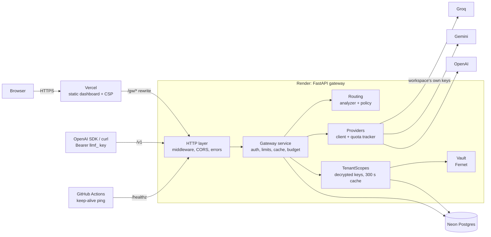
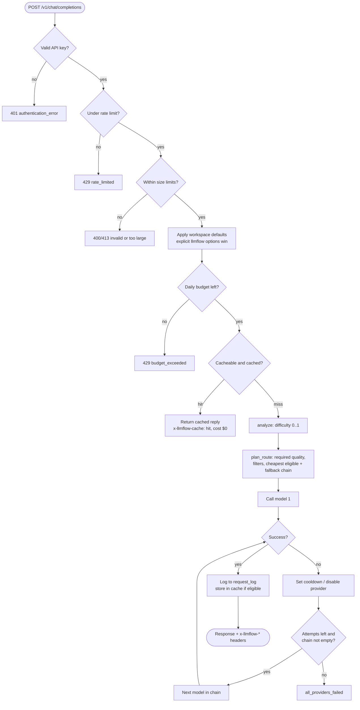
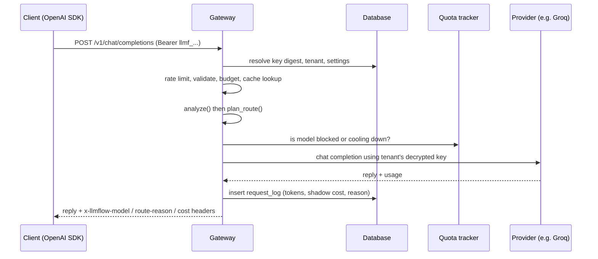
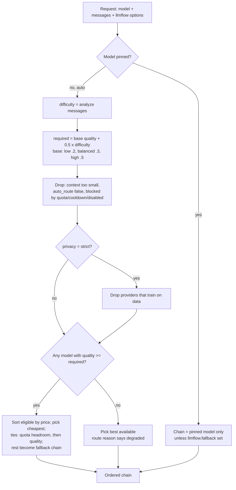
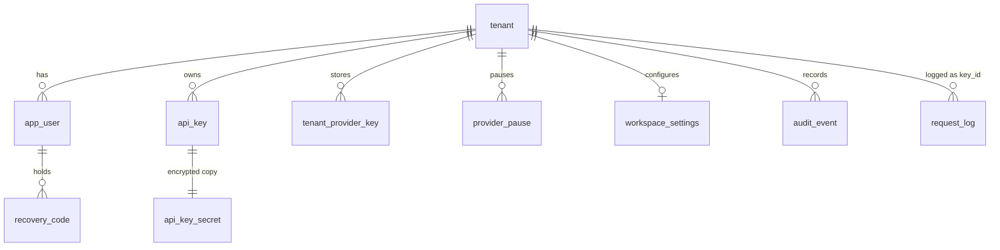
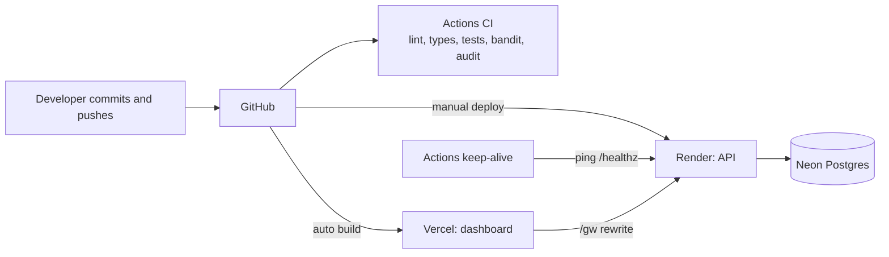

# LLMFlow: the single source of truth

> **Rule:** this file is the canonical description of the project. If code, configuration, deployment or behaviour changes, update this file in the same change. If another document disagrees with this one, this one wins (then fix the other). Secrets never appear here.

Last verified against the code: 2026-10-19.

## Contents

1. [What LLMFlow is](#1-what-llmflow-is)
2. [Status and live URLs](#2-status-and-live-urls)
3. [Tech stack](#3-tech-stack)
4. [Repository map](#4-repository-map)
5. [Architecture](#5-architecture)
6. [The request pipeline](#6-the-request-pipeline)
7. [Routing](#7-routing)
8. [Caching, budgets, quotas and fallback](#8-caching-budgets-quotas-and-fallback)
9. [Database](#9-database)
10. [HTTP API reference](#10-http-api-reference)
11. [Authentication and security model](#11-authentication-and-security-model)
12. [Cryptography and secret handling](#12-cryptography-and-secret-handling)
13. [Provider catalog](#13-provider-catalog)
14. [Configuration reference](#14-configuration-reference)
15. [Dashboard](#15-dashboard)
16. [Deployment and operations](#16-deployment-and-operations)
17. [CI, testing and quality gates](#17-ci-testing-and-quality-gates)
18. [Benchmarks](#18-benchmarks)
19. [Commands cheat sheet](#19-commands-cheat-sheet)
20. [Decisions and constraints](#20-decisions-and-constraints)
21. [Known limitations](#21-known-limitations)
22. [Glossary](#22-glossary)
23. [Maintenance rules](#23-maintenance-rules)

---

## 1. What LLMFlow is

LLMFlow is a **provider-agnostic, OpenAI-compatible LLM gateway** that sends each request to the **cheapest model that meets a quality setting**, using each workspace's **own provider keys (BYOK)**.

- **Drop-in:** any OpenAI SDK works by changing `base_url` and the API key. Request model `auto` (or omit it) to let the router choose; pin a catalog model id to bypass routing.
- **Quality dial:** each request (or the workspace default) is `low`, `balanced` or `high`. Together with a difficulty score of the prompt, this sets a quality bar. The cheapest model at or above the bar wins; the rest form the fallback chain.
- **Multi-tenant:** each signed-up workspace stores its own provider keys (encrypted), creates its own `llmf_…` API keys, and sees only its own usage.
- **Savings are "shadow cost":** the real spend is ₹0 (free tiers). Shadow cost = tokens × the model's published paid list price, so comparisons between strategies are meaningful.
- **Extras:** exact response cache, daily budgets, automatic fallback with cooldowns, per-workspace audit log, analytics dashboard, playground, TOTP two-factor, recovery codes, session management.

Constraints that shaped it: ₹0 budget, cloud-only (nothing trains or runs models locally), security first because the service holds multiple users' provider keys.

What it is **not**: the router is **rule-based with a quality dial**, not a learned or adaptive model. A learned predictor was evaluated and rejected (measured AUC about 0.54 on 96 items), so no per-request prediction accuracy is claimed.

## 2. Status and live URLs

| Piece | Where | Notes |
|---|---|---|
| Dashboard + landing | `https://llmflow-gateway.vercel.app` | Vercel, static Vite build |
| Gateway API | `https://llmflow-api.onrender.com` | Render free web service, region Singapore; sleeps after about 15 min idle (a keep-alive workflow pings it) |
| Database | Neon Postgres (Singapore) | free plan, scale-to-zero after 5 min |
| Browser-side API path | `/gw/*` on the Vercel domain | rewrites to the Render API, so the browser only talks to its own origin |

Sign-up on the live demo is **invite-code only** (`LLMFLOW_SIGNUP_CODE`). Groq and Gemini routing have been verified live; OpenAI is configured in the catalog but **not yet tested live**.

## 3. Tech stack

**Backend** (`backend/`)
- Python 3.12+ (Render runs 3.13.5), FastAPI 0.143, uvicorn
- httpx (async, streaming) for provider calls
- Pydantic v2 + pydantic-settings (env prefix `LLMFLOW_`)
- SQLAlchemy 2.x async; aiosqlite locally, asyncpg + Neon Postgres in production; tables created on startup with `create_all`, **no migrations** (new features add new tables, not columns)
- PyYAML for the model catalog
- `cryptography` (Fernet/MultiFernet) for secrets at rest, argon2-cffi for password hashing
- Dev tools: pytest (+asyncio, respx), ruff (line length 100; rules E,F,I,B,UP,S,C4,SIM,RUF), mypy `--strict`, bandit, pip-audit
- `requirements.lock` is used for production installs

**Dashboard** (`dashboard/`)
- Vite 8, React 19, TypeScript 7, hash routing (`#/…`)
- Geist Sans/Mono (`@fontsource-variable`), lucide-react icons, hand-built SVG charts
- `react-markdown`, `remark-gfm`, `remark-math`, `rehype-katex`, `katex` (Playground renders Markdown and LaTeX; raw HTML is never rendered. `\( \)`, `\[ \]` and `$...$` are all read as math, but `$...$` only when it contains a LaTeX command such as `\frac`, so dollar amounts like "$650,000 and $420,000" stay plain text)
- `@vercel/analytics` for privacy-friendly page analytics (URLs stripped)
- vitest 5 + Testing Library

**Infra:** Vercel (dashboard), Render (API), Neon (Postgres), GitHub Actions (CI + keep-alive). All on free tiers.

## 4. Repository map

```
AGENT.md              working rules for AI agents and contributors
README.md             public overview with screenshots
SECURITY.md           vulnerability reporting policy
llmflow.md            this file
render.yaml           Render blueprint for the API
backend/
  config/             catalog.yaml, catalog.d/*.yaml, optional routing.json
  src/llmflow/
    service.py        Gateway: the request pipeline
    budget.py         daily budget guard
    catalog.py        providers/models loader
    tenancy.py        per-workspace scopes (decrypted providers, quota)
    api/              FastAPI app, routes (v1, auth, account, admin), sessions, reauth
    core/             settings (config.py), errors, auth, rate limiting
    providers/        OpenAI-compatible client, quota tracker
    routing/          analyzer (difficulty), policy (plan_route), config
    security/         passwords, totp, vault (Fernet)
    storage/          SQLAlchemy models + tenant repository
    bench/            benchmark runner, checkers, router evaluation
    tools/            add_provider, rotate_master_key
  scripts/            smoke_test.py, seed_dev_data.py
  tests/              14 test files
dashboard/
  src/                App, pages, components, lib (api, store, route, chat, …)
  public/             static assets, Search Console verification file
  vercel.json         build, rewrite, security headers, CSP
benchmarks/           suite/ (question sets), results/ (raw runs + reports)
docs/                 DEPLOY, SECURITY, TESTING, design-system, providers, PLAN (historical), research/, assets/
scripts/              dev.mjs, demo.mjs, ops.mjs, brand_assets.py
examples/             openai_quickstart.py
.github/workflows/    ci.yml, keepalive.yml
```

## 5. Architecture

```
 Browser ──► Vercel (static dashboard, CSP, /gw rewrite)
                 │  /gw/*
                 ▼
            Render: FastAPI gateway ───► Groq / Gemini / OpenAI (workspace's own keys)
                 │
                 ▼
            Neon Postgres (tenants, users, encrypted keys, usage, audit)

 OpenAI SDK / curl ──► Render directly or via /gw/v1  (Bearer llmf_… key)
```

### 5.1 System diagram



### 5.2 Layers inside the API

1. **HTTP layer** (`api/`): routing, validation, security-headers and body-limit middleware, CORS, error-shape handlers.
2. **Gateway** (`service.py`): auth context, limits, cache, budget, routing, execution with fallback, usage logging.
3. **Routing** (`routing/`): `analyze()` scores difficulty; `plan_route` picks the chain.
4. **Providers** (`providers/`): OpenAI-compatible HTTP client, per-model quota tracker.
5. **Tenancy** (`tenancy.py`): `TenantScopes` caches a per-workspace `Scope` (decrypted provider objects) for 300 s (max 256 entries).
6. **Storage** (`storage/`): async SQLAlchemy.
7. **Security** (`security/`): argon2id, TOTP, Fernet vault.

Three separate credentials, never interchangeable:
- **API keys** (operator keys or workspace `llmf_…`): `/v1` only.
- **User sessions** (email + password, optional TOTP): `/account/*`, `/auth/*`.
- **Operator admin key**: `/admin/*`, Bearer only, used via `npm run ops`. There is no admin web UI.

API keys calling `/account/*` receive 403.

## 6. The request pipeline

For `POST /v1/chat/completions`, in order:

1. **Authenticate**: operator API key or workspace `llmf_…` key (SHA-256 digests, constant-time compare). Per-IP auth-failure throttle (20/min).
2. **Rate limit** per key: `rate_limit_rpm` (default 60), sliding window.
3. **Validate size**: body ≤ `max_body_bytes` (512000), messages ≤ 200, prompt ≤ 200000 chars, `max_tokens` capped at 8192, `n > 1` rejected.
4. **Apply workspace defaults** (default quality, cache mode, budgets). Explicit per-request `llmflow` options win.
5. **Budget check** (`BudgetGuard`): UTC-day shadow cost and tokens. Effective limit is the stricter of platform and workspace limits. Over → `budget_exceeded`.
6. **Exact cache** (non-stream only): see section 8. A hit returns immediately with `x-llmflow-cache: hit` and zero cost.
7. **Analyze** the prompt into a difficulty score in [0, 1].
8. **Plan the route**: required quality = base[quality] + span × difficulty; filter and sort candidates (section 7).
9. **Execute** up to `max_attempts` (3) through the chain, applying cooldowns on failures.
10. **Stream or return**: streaming can fall back only before the first byte; `stream_options.include_usage` is requested unless the provider has `stream_usage: false`. If a provider reports no usage while streaming, tokens are estimated (about 4 chars per token) and the log notes it.
11. **Log** to `request_log` (tokens, latency, shadow cost, attempts, route reason ≤ 512 chars, cache status).
12. **Respond** with headers `x-llmflow-model`, `-provider`, `-attempts`, `-route-reason`, `-shadow-cost-usd`, `-cache`.

### 6.1 Pipeline flowchart



### 6.2 Sequence of one routed request



Request options live under a top-level `llmflow` object in the body: `quality` (`low|balanced|high`), `cache` (`on|off`), `fallback`, `privacy` (`strict`).

## 7. Routing

### Difficulty analyzer (v2, `routing/analyzer.py`)
Produces a score from weighted features: length 0.15, code 0.15, math 0.10, reasoning 0.20, structured 0.05, turns 0.05, long_output 0.05, numeric_load 0.10, digit_span 0.10, operators 0.05. Date strings are masked so they do not look like arithmetic. v1 is kept for comparison.

### Policy (`routing/policy.py`)
- `required = base[quality] + span × difficulty`, defaults: base low 0.2, balanced 0.3, high 0.5; span 0.5. Overridable by optional `backend/config/routing.json`.
- **Filters:** context window must fit; model not blocked by quota/cooldown/provider-disabled; strict privacy excludes providers with `trains_on_data: true`; models with `auto_route: false` are never auto-picked.
- **Choice:** cheapest model with `quality >= required`; ties broken by quota headroom, then higher quality. The remaining candidates form the fallback chain.
- If nothing meets the bar, the best available is used and the route reason says **degraded**.
- **Pinned model:** the chain is the pinned model only, unless `llmflow.fallback` is explicitly set.

Quality values in the catalog are configured priors, informed by the benchmarks where noted; they are not self-updating.

### 7.1 Routing decision tree



## 8. Caching, budgets, quotas and fallback

**Exact response cache**
- Applies to non-streaming requests where `temperature == 0` or `llmflow.cache == "on"`.
- Key = SHA-256 over model, messages, temperature, top_p, max_tokens, other sampling params, `n`, plus tenant/key id and the routing options (quality, privacy).
- TTL `cache_ttl_s` 3600, max 500 entries, entries over 64 KB are not cached. In-process only.

**Budgets**
- Daily (UTC) shadow-cost and token limits, platform-wide (`LLMFLOW_DAILY_BUDGET_USD`, `LLMFLOW_DAILY_TOKEN_BUDGET`) and per workspace (Workspace page). The stricter one applies.

**Quota tracker** (`providers/quota.py`, process-local)
- Rolling windows (60 s and 24 h) per model for rpm, tpm, rpd, tpd from the catalog limits.
- Cooldowns: rate_limited 30 s (or `Retry-After`), server error 15 s, timeout 15 s, not_found 300 s. An auth error disables that provider **for that tenant** until keys are updated.
- Updating or pausing keys calls `invalidate`, which clears provider-disabled flags and cooldowns but keeps counters.
- `why_blocked` explains skips; skipped and failed attempts are appended to the route reason.

**Fallback**
- Up to `max_attempts` (3) models in the chain. Non-stream failures retry the next model; streams only before the first byte.

## 9. Database

Local default `sqlite+aiosqlite:///./llmflow.db`; production Neon Postgres via `LLMFLOW_DATABASE_URL` (direct, non-pooled URL). Tables are created at startup; there are no migrations.

| Table | Columns (summary) |
|---|---|
| `tenant` | id, name, created_at, disabled |
| `app_user` | id, tenant_id, email (unique), password_hash, created_at, last_login_at, failed_logins, locked_until, mfa_enabled, mfa_secret_ct, mfa_last_step |
| `api_key` | id, tenant_id, name, key_hash (unique), last4, created_at, last_used_at, revoked_at |
| `api_key_secret` | key_id (PK), tenant_id, ciphertext (so the owner can reveal their key) |
| `tenant_provider_key` | id, tenant_id, provider, ciphertext, last4, created_at |
| `provider_pause` | tenant_id + provider (PK), paused_at |
| `workspace_settings` | tenant_id (PK), cache_mode, default_quality, daily_budget_usd, daily_token_budget, updated_at |
| `recovery_code` | id, user_id, code_hash, used_at |
| `audit_event` | id, tenant_id, ts, actor, action, detail (≤ 300), ip |
| `request_log` | id, ts, key_id (= tenant id for workspace callers), requested_model, model, provider, status, prompt_tokens, completion_tokens, latency_ms, shadow_cost_usd, attempts, route_reason, cache_status |

Prompts and completions are **not** stored; only metadata above.

### 9.1 Entity relationships



Notes: Deleting a workspace cascades through every tenant table and its `request_log` rows.

## 10. HTTP API reference

Errors always have the shape `{"error": {"type": "...", "message": "..."}}`. Types: `authentication_error`, `forbidden`, `not_found`, `invalid_request_error`, `byok_not_configured`, `conflict`, `rate_limited`, `budget_exceeded`, `no_provider_keys`, `no_available_model`, `all_providers_failed`, `model_not_found`, `request_too_large`, `internal_error`.

CORS allows GET/POST/PUT/DELETE and exposes `x-llmflow-*` and `retry-after`. Middleware adds security headers and enforces the body limit. Interactive docs (`/docs`) are disabled in production (`LLMFLOW_ENABLE_DOCS=false`).

**Public**
- `GET /healthz`
- `GET /public/info`: `byok_enabled`, `signup_enabled`, `invite_code_required`, `password_min_length`

**Gateway (`Authorization: Bearer <api key>`)**
- `GET /v1/models`
- `POST /v1/chat/completions` (OpenAI schema + optional `llmflow` object)

**Auth** (`/auth/…`; session cookie + CSRF header where signed in)
- `POST signup`, `login`, `login/mfa`, `logout`, `recover`, `change-password`
- `GET session`
- `POST mfa/setup`, `mfa/enable`, `mfa/disable`
- `POST recovery-codes` (regenerate)
- `DELETE workspace` (requires password)

**Account** (`/account/…`, session only)
- `GET /account`, `GET|PUT /settings`
- `GET /sessions`, `POST /sessions/revoke-others`, `DELETE /sessions/{id}`
- `GET|POST /api-keys`, `POST /api-keys/{id}/reveal`, `DELETE /api-keys/{id}`
- `PUT /provider-keys/{provider}`, `DELETE /provider-keys/{provider}` (password), `POST …/reveal`, `POST …/pause`
- `GET /audit`, `GET /overview`, `GET /requests`
- `POST /chat` (Playground)

**Admin** (`/admin/…`, operator admin key only)
- `GET overview`, `requests`, `providers`, `budgets`, `config`, `benchmarks`, `tenants`
- `POST tenants/{id}/{action}`, `DELETE tenants/{id}`

## 11. Authentication and security model

- **Passwords:** argon2id; minimum length from `/public/info`; dashboard enforces capitals, digits, specials and common-pattern checks.
- **Login lockout:** 5 failures → locked 900 s. Sign-up limited to 5/hour per IP.
- **Sessions:** `llmflow_session` HttpOnly cookie (SameSite lax by default) + `x-llmflow-csrf` header. Idle timeout 1800 s, absolute 43,200 s. Stored in process memory (a restart signs everyone out). Users can list and revoke sessions.
- **MFA:** TOTP per RFC 6238 (SHA-1, 6 digits, 30 s, ±1 step), replay protection via `mfa_last_step`. Login challenge token TTL 300 s, 5 attempts.
- **Recovery codes:** 10 one-time codes (`XXXX-XXXX-XXXX`, 60 bits), stored as SHA-256 hashes. Using or regenerating them revokes sessions.
- **Re-authentication:** removing a provider key, changing the password, disabling MFA and deleting the workspace all require the password.
- **API keys:** `llmf_…`, stored as SHA-256 digests; the owner can reveal them through an encrypted copy (`api_key_secret`) after re-auth.
- **Isolation:** every query is scoped by tenant id; ciphertexts are bound to tenant and purpose (below).
- **Network hardening:** strict CSP on the dashboard, nosniff, frame denial, HSTS, no-referrer, COOP; the API sets security headers and a body-size limit; Markdown output never renders raw HTML and drops unsafe link schemes; chart/markdown links open with `noopener noreferrer nofollow`.
- **Trust model:** this is a hosted service, so prompts and decrypted keys pass through server memory while a request is served. Prompts are not persisted.

### 11.1 Login flow

```mermaid
sequenceDiagram
  participant B as Browser
  participant A as /auth API
  participant D as Database
  B->>A: POST /auth/login (email, password)
  A->>D: load user; check locked_until
  alt wrong password
    A->>D: failed_logins + 1 (5 failures locks 900 s)
    A-->>B: 401
  else correct, MFA off
    A-->>B: Set-Cookie llmflow_session (HttpOnly) + csrf token
  else correct, MFA on
    A-->>B: challenge token (300 s, 5 attempts)
    B->>A: POST /auth/login/mfa (token, TOTP or recovery code)
    A->>D: verify step > mfa_last_step; store step
    A-->>B: Set-Cookie llmflow_session + csrf token
  end
  B->>A: later requests send cookie + x-llmflow-csrf header
```

### 11.2 Where each credential works

```mermaid
flowchart LR
  K[API key llmf_ or operator key] --> V1[/v1/*]
  S[User session cookie + CSRF] --> AC[/account/* and /auth/*]
  AD[Operator admin key Bearer] --> AM[/admin/* via npm run ops]
  K -. 403 .-> AC
```

## 12. Cryptography and secret handling

- **Vault:** Fernet. Ciphertext is JSON that binds the **tenant id** and **purpose** (provider name, `api_key:{key_id}`, or `mfa`), so a ciphertext copied to another row or tenant will not decrypt.
- **Master key:** `LLMFLOW_MASTER_KEY` is a comma-separated list; the first encrypts, all decrypt (MultiFernet). Rotate with `npm run rotate-master-key` (`backend/src/llmflow/tools/rotate_master_key.py`), then remove the old key from the list. Losing the master key makes stored provider keys unrecoverable, so keep an offline backup.
- **No secrets in the repo:** `.env` files are git-ignored; docs and tests use throwaway values only; CI runs bandit and pip-audit. Operators should rotate any credential that was ever pasted into chat or logs.

## 13. Provider catalog

Defined in `backend/config/catalog.yaml` plus `catalog.d/*.yaml`. Prices are USD per 1M tokens (in/out) and drive shadow cost; quality is a configured prior.

| Provider | Base URL | Env key | Trains on data | Streaming usage |
|---|---|---|---|---|
| groq | `https://api.groq.com/openai/v1` | `GROQ_API_KEY` | no | yes |
| gemini | Google's OpenAI-compatible endpoint | `GEMINI_API_KEY` | yes | no (estimated) |
| openai | `https://api.openai.com/v1` | `OPENAI_API_KEY` | no | yes |

| Model id | Provider | Tier | Quality | Context | $ in / out | Auto-route |
|---|---|---|---|---|---|---|
| groq-gpt-oss-20b | groq | small | 0.50 | 131,072 | 0.075 / 0.30 | yes |
| groq-qwen3.8-27b | groq | medium | 0.65 | 131,072 | 0.80 / 4.00 | **no (pin only)** |
| groq-gpt-oss-120b | groq | large | 0.80 | 131,072 | 0.15 / 0.60 | yes |
| gemini-3.1-flash-lite | gemini | small | 0.55 | 1,000,000 | 0.25 / 1.50 | yes |
| gemini-3.5-flash-lite | gemini | medium | 0.70 | 1,000,000 | 0.30 / 2.50 | yes |
| gemini-3.8-flash | gemini | large | 0.88 | 1,000,000 | 0.75 / 3.75 | yes |
| openai-gpt-4o-mini | openai | small | 0.60 | 128,000 | 0.15 / 0.60 | yes |
| openai-gpt-4o | openai | large | 0.85 | 128,000 | 2.50 / 10.00 | yes |

Groq local limits: 30 rpm, 1000 rpd, 8000 tpm, 200,000 tpd per model. Gemini has no local limits configured. Qwen is pin-only because it scored below both gpt-oss models at higher cost in the benchmarks.

**Adding a provider:** `python -m llmflow.tools.add_provider` (or `npm run provider`) or drop a YAML into `catalog.d/`. Any OpenAI-compatible endpoint works. See `docs/providers.md`.

## 14. Configuration reference

All settings come from environment variables with prefix `LLMFLOW_` (`backend/src/llmflow/core/config.py`).

| Variable | Default | Meaning |
|---|---|---|
| `API_KEYS` | none | operator API keys for `/v1` |
| `ADMIN_API_KEYS` | none | operator admin keys for `/admin` |
| `AUTH_DISABLED` | false | local dev only |
| `MIN_KEY_LENGTH` | 16 | minimum operator key length |
| `AUTH_FAIL_LIMIT_PER_MIN` | 20 | per-IP auth failure throttle |
| `TRUST_FORWARDED_FOR` | false | true behind Render/Vercel proxies |
| `MASTER_KEY` | none | Fernet key list (required for BYOK) |
| `SIGNUP_ENABLED` / `SIGNUP_CODE` / `SIGNUP_LIMIT_PER_HOUR` | / / 5 | sign-up gating |
| `LOGIN_MAX_FAILURES` / `LOGIN_LOCK_S` | 5 / 900 | lockout |
| `SESSION_IDLE_S` / `SESSION_MAX_AGE_S` | 1800 / 43200 | session lifetime |
| `SESSION_COOKIE_SAMESITE` | lax | `lax`, `strict` or `none` |
| `DATABASE_URL` | sqlite local | SQLAlchemy async URL |
| `CATALOG_PATH` / `ROUTING_CONFIG_PATH` / `BENCHMARKS_DIR` | repo defaults | file locations |
| `REQUEST_TIMEOUT_S` / `MAX_ATTEMPTS` | 60 / 3 | provider call policy |
| `RATE_LIMIT_RPM` | 60 | per-key limit |
| `MAX_BODY_BYTES` / `MAX_MESSAGES` / `MAX_PROMPT_CHARS` / `MAX_TOKENS_CAP` | 512000 / 200 / 200000 / 8192 | request limits |
| `DAILY_BUDGET_USD` / `DAILY_TOKEN_BUDGET` | unset | platform daily caps |
| `CACHE_TTL_S` / `CACHE_MAX_ENTRIES` | 3600 / 500 | cache |
| `CORS_ORIGINS` | none | allowed dashboard origins |
| `ENABLE_DOCS` | false | OpenAPI UI |
| `LOG_LEVEL` | info | logging |

Provider env keys (`GROQ_API_KEY`, `GEMINI_API_KEY`, `OPENAI_API_KEY`) provide operator-level fallbacks; workspaces normally bring their own.

Dashboard: `VITE_GATEWAY_URL` (default `http://localhost:8000`; in production the build uses `/gw`).

## 15. Dashboard

Hash-routed single-page app.

- **Public:** `#/` landing, `#/signin`, `#/signup`, `#/recover`. The landing page renders without waiting for the API.
- **Signed in:** Overview (stats, charts, routing mix, savings, table view), Requests (log), Providers (add/update/reveal/pause/remove keys), API keys, Connect (copy-paste snippets), Playground (a chat with Markdown/LaTeX output), Workspace (defaults, budgets, audit, delete), Account (password, MFA, recovery codes, sessions).
- **Playground conversations:** a chat is one list of messages held in the browser. Every send carries that chat's messages, so replies stay in context even when the router picks a different model each turn (every model receives plain `messages`). "New chat" empties the list. The chat is one card whose height follows the Options + Routing column beside it, so both end on the same line (the Routing box has a fixed height, scrolling internally, so nothing resizes when a reply arrives): messages scroll inside it and the message bar stays pinned at its bottom. Each finished reply has a copy icon under it. Nothing is stored on the server. To protect the free tiers' per-minute token limits and the cost savings, the history sent is capped at about 16,000 characters (about 4,000 tokens): the oldest messages are dropped first, the newest message is always kept, and the sent history always starts on a user message (`trimHistory` in `dashboard/src/lib/chat.ts`). When trimming happens the page says so. The gateway itself stays stateless like the OpenAI API: API clients send their own history.
- **State:** in-memory CSRF token + HttpOnly cookie session; no tokens in localStorage.
- **Design:** tokens in `docs/design-system.md` (light `#f9f9f7`, dark `#0d0d0d`, accent blue, radius ≤ 6 px except the Playground message box (pill-shaped container with a concentric round send button), no gradients, glow or emoji, 28 px controls). Charts are hand-built SVG with a table fallback.
- **SEO and analytics:** `dashboard/seo.ts`, Search Console verification file in `dashboard/public/`, Vercel Web Analytics with URL stripping.

## 16. Deployment and operations

**Render (API):** `render.yaml` defines `llmflow-api` (free, Singapore, root `backend`), build `pip install -r requirements.lock`, start `uvicorn --factory llmflow.api.app:create_app`, health check `/healthz`, `autoDeploy: false` (deploy manually). Secrets (`GROQ_API_KEY`, `MASTER_KEY`, `SIGNUP_CODE`, `DATABASE_URL`, `CORS_ORIGINS`) are set in the Render dashboard (`sync: false`).

**Vercel (dashboard):** `dashboard/vercel.json` sets the build, the `/gw/:path*` rewrite to the Render API, and the security headers/CSP.

**Neon:** use the direct (non-pooled) URL. Free plan has limited compute hours and scales to zero.

**Keep-alive:** an external monitor (cron-job.org, every 1 min, `GET /healthz`) keeps the Render API awake; `.github/workflows/keepalive.yml` is a best-effort backup (GitHub delays or skips scheduled runs). `/healthz` never touches the database, so Neon still scales to zero when nobody is using the product. It wakes on demand: the `db_ready` dependency (`api/deps.py`) on `/auth/signup`, `/auth/login`, `/auth/login/mfa` and `/auth/recover` calls `UsageRepo.ensure_awake()`, which retries a `SELECT 1` (4 attempts, growing delay, 30 s connect timeout) while Neon resumes, is free for 120 s after a success, and answers 503 `service_unavailable` (Retry-After 5) if the database never comes up. There is deliberately no public wake-up endpoint, so nobody can keep Neon awake without going through the already-throttled auth routes. Render's 750 free hours per month are roughly fully used by a single always-on service.

**Operator tasks**
- Redeploy API: Render dashboard → Manual Deploy (needed for backend/config changes; docs-only changes need none).
- Admin views: `npm run ops`.
- Rotate master key: `npm run rotate-master-key`.
- Local development: `npm run dev` (creates venv, installs dependencies, generates `.env`, starts API on :8000 and Vite on :5173).

Full walkthrough: `docs/DEPLOY.md`.

### 16.1 Deployment topology and delivery



## 17. CI, testing and quality gates

`.github/workflows/ci.yml`
- **Backend (Python 3.13):** ruff check and format, mypy `--strict`, pytest, bandit, pip-audit.
- **Dashboard (Node 22):** `npm ci`, typecheck, vitest, build, `npm audit --omit=dev`.

Current counts: 187 backend tests, 68 dashboard tests; lint, types and security scans clean; `npm audit` reports 0. Provider calls in tests are mocked (respx). `npm run smoke` exercises a running gateway; `npm run check` runs the full local gate. See `docs/TESTING.md`.

## 18. Benchmarks

Measured with real Groq calls at temperature 0 and **deterministic checkers (no LLM judge)**. Suites in `benchmarks/suite/`: `core44`, `hard21`, `gsm8k36`, `synth36`, `synthx24`. Raw results and reports in `benchmarks/results/` (`*.jsonl`, `report.json`, `report.md`, `router-eval-20261014.txt`).

Headline results (pooled 96 items):

| Strategy | Accuracy | Shadow cost | vs always-large |
|---|---|---|---|
| always-large | 99.0% | $0.0379 | baseline |
| always-small | 89.6% | $0.0250 | −34% |
| oracle (best possible pick) | 99.0% | $0.0242 | −36% |

- GSM8K sample: 97% accuracy at −39% cost.
- Routed `balanced` on easy and medium prompts: 100% at −45%.
- Cache hits cost $0.
- Router evaluation (counterfactual replay): analyzer v2 AUC 0.537 on 96 items with 9 escalation cases, which is why no per-request prediction claim is made.

Run with `npm run bench` and `npm run bench:report`. Benchmark numbers are a sample, not a guarantee.

## 19. Commands cheat sheet

| Command | Purpose |
|---|---|
| `npm run dev` | local API + dashboard |
| `npm run demo` | demo run |
| `npm run smoke` | smoke test against a running gateway |
| `npm run test` / `npm run check` | tests / full gate |
| `npm run bench` / `bench:report` | benchmarks / report |
| `npm run ops` | operator admin CLI |
| `npm run provider` | add a provider to the catalog |
| `npm run rotate-master-key` | re-encrypt secrets under a new master key |
| `npm run build` | build the dashboard |
| `python backend/scripts/seed_dev_data.py <db-url>` | synthetic rows for UI work in a **local** DB only |
| `python examples/openai_quickstart.py` | OpenAI SDK example |

## 20. Decisions and constraints

- **Cloud only, no local models:** nothing is trained or run on the developer's laptop.
- **BYOK:** each workspace's provider keys, encrypted with the vault; the gateway owns no paid keys.
- **Rule-based router with a quality dial:** simple, explainable and honest; the learned alternative failed evaluation.
- **No migrations:** new features use new tables.
- **Process-local state** (rate limits, cache, quota, sessions): fine for one free instance; see limitations.
- **Docs claim only what is measured;** shadow cost is not real spend.
- **Git:** contributors and agents never commit or push without approval; the owner runs git.
- **Design:** premium, non-"AI-looking": restrained palette, no gradients or emoji.

## 21. Known limitations

- Routing is rule-based; quality priors are configured, not learned.
- Single instance: rate limits, cache, quota counters and sessions live in memory and reset on restart.
- No email verification, SSO or team roles; sign-up is invite-only on the live demo.
- Render's free API sleeps when idle; the keep-alive reduces but does not eliminate cold starts.
- OpenAI is untested live; Gemini streaming reports no usage, so tokens are estimated.
- Hosted trust model: prompts and decrypted keys pass through server memory.
- Free-tier provider quotas and model names change; the catalog needs periodic review.

## 22. Glossary

- **BYOK:** bring your own key; the workspace supplies its provider keys.
- **Shadow cost:** tokens × published paid list price; what the request would cost on a paid plan.
- **Quality dial:** `low | balanced | high` setting that raises or lowers the required model quality.
- **Difficulty score:** 0–1 estimate of how demanding a prompt is.
- **Fallback chain:** ordered list of other eligible models tried when one fails.
- **Cooldown:** temporary skip of a model/provider after an error.
- **Scope:** a workspace's cached, decrypted provider setup.
- **Workspace / tenant:** one signed-up account and everything it owns.

## 23. Maintenance rules

1. Any change to behaviour, endpoints, schema, configuration, deployment, models/prices or limits updates this file in the same change.
2. Re-verify numbers (tests, benchmarks, catalog) before editing them here; do not invent measurements.
3. Never place secrets, real keys, passwords or private URLs with credentials in this file.
4. Keep `AGENT.md` (working rules), `README.md` (public pitch) and `docs/` (deep dives) consistent with this file.
